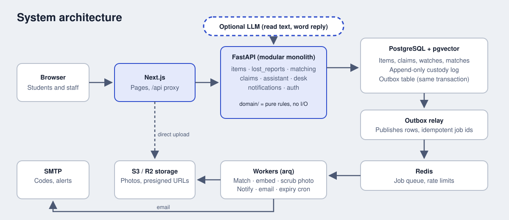
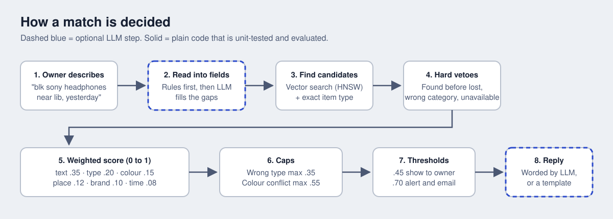

<p align="center">
  
</p>

<p align="center">
  
  
  
  
  
  
</p>

A lost-and-found platform for a university campus. Finders report items, owners search in plain
language and get notified when a match appears later, and desk staff track every item's custody
from handover to return, donation or disposal.

**Stack:** FastAPI · PostgreSQL 16 + pgvector · Redis + arq · S3-compatible storage · Next.js 15
(React 19, TypeScript) · optional OpenAI-compatible LLM (Groq, Gemini, Ollama)

> Built as a system-design exercise: the interesting parts are the matching pipeline, the
> transactional outbox, the privacy model and the decision to keep the LLM out of the critical
> path. Start with [docs/design.md](docs/design.md) and the [ADRs](docs/adr).

## The problem

Lost items end up scattered across security desks, library counters and chat groups. Owners
don't know where to look, finders don't know who to hand items to, and desks have no record of
who found what or who collected it.

| User | Needs |
|---|---|
| **Finder** | Report an item in about a minute: photo, where and when, who has it now. |
| **Owner** | Describe what was lost, see likely matches and where the item is, and be told later if nothing matches yet. |
| **Desk staff** | Receive items, keep a tamper-evident custody history, approve claims, and close out unclaimed items. |

## Screenshots

<!--
Add real screenshots from the running app to docs/screenshots/, then delete this comment:

| Student: describe a lost item | Desk: recently handed in |
|---|---|
|  |  |

| Finder: report an item | Owner: claim with proof |
|---|---|
|  |  |
-->

## Features

- **Report found items** with a photo (EXIF location data removed), location, time and holder.
- **Assistant search** for owners: free-text description in, ranked matches out, with where each item is held.
- **Watches:** if nothing matches, the description is saved and the owner is alerted by in-app
  notification and email when a match is reported.
- **Claims with proof:** the owner must describe something only they would know. Staff approve or
  reject; only one claim per item can ever be approved.
- **Desk dashboard** (staff only): recently handed in, claims, finders, expired items, search.
  Expired items can be donated, disposed of or extended.
- **Privacy by default:** students never see a list of all found items; sensitive items (wallets,
  ID cards, keys) show a generic title with no photo or description.

## Architecture

<p align="center">
  
</p>

**Modular monolith.** One deployable backend split into bounded contexts (`items`, `lost_reports`,
`matching`, `claims`, `assistant`, `notifications`, `desk`, `auth`). Business rules live in a
framework-free `domain/` package that is unit-tested without a database. See
[ADR 001](docs/adr/001-modular-monolith.md).

**Request flow for a new found item**

1. The browser uploads the photo straight to storage with a presigned URL; the API never proxies
   image bytes.
2. The API saves the item and an event row **in the same database transaction** (transactional outbox).
3. A relay publishes outbox rows to the job queue. Jobs use idempotent IDs, so retries are safe.
4. Workers scrub and re-encode the photo, compute the embedding, match the item against every open
   lost report, and create notifications. Each match pair and each notification has a uniqueness
   constraint, so reprocessing cannot create duplicates.

### Design decisions

| Decision | Why |
|---|---|
| Modular monolith, not microservices | One team, one database, strong consistency needed for claims. Module boundaries keep the option to split later. |
| Transactional outbox + idempotent consumers | Guarantees that "item saved" and "notify watchers" cannot drift apart if a process crashes between them. ([ADR 003](docs/adr/003-transactional-outbox.md)) |
| Deterministic matching | Predictable, testable and explainable. See the next section. ([ADR 002](docs/adr/002-deterministic-matching.md)) |
| Partial unique index: one approved claim per item | Concurrency safety enforced by the database, not by application checks. |
| Append-only `custody_events` (DB trigger) | Audit history cannot be edited or deleted by application code. |
| Optimistic `version` column on items | Detects concurrent edits instead of silently overwriting. |
| Keyset pagination | Stable and fast on large tables, unlike offset pagination. |
| Redis sliding-window rate limits | Limits sign-in codes, reports, claims and assistant calls per user (or per IP when signed out). |
| Passwordless email-code login, httpOnly cookie, CSRF header | No passwords to store or leak; swap for campus SSO later. |
| Multi-tenant by `campus_id` | Every table is scoped so more than one campus can share a deployment. |
| Staff-only item browsing | Prevents students from scrolling through everything to find something to claim. ([ADR 004](docs/adr/004-privacy-by-default.md)) |

## Where an LLM is used, and where it is not

The LLM is optional and sits at the edges. The system works with no LLM configured.

| Step | Uses an LLM? | Why |
|---|---|---|
| Reading the owner's free-text description into fields (type, colour, brand, place, time) | **Yes, as a fallback only.** Rules run first; the LLM fills in only what the rules missed. | Free text is messy ("blk sony headphones near lib"). This is the task language models are good at. |
| Wording the assistant's reply | **Yes.** | Natural phrasing. The LLM rewords results the code already chose; it cannot add or change matches. |
| **Matching and ranking** | **No.** Weighted scoring code. | An LLM can invent a match, is not reproducible, and costs latency and money per comparison. Scoring in code can be unit-tested and evaluated. |
| **Deciding who gets notified** | **No.** Thresholds in code. | A wrong alert tells a stranger an item exists. This must be predictable. |
| Reporting a found item | **No.** Rules only. | Finders fill in a structured form, so extraction adds little. |
| Claim review and proof handling | **No.** The proof text is never sent to an LLM. | Proof is the only thing that separates an owner from someone fishing. It stays private. |
| Embeddings (text similarity) | **No LLM.** Built-in hashing embedder by default; optional local `bge-small-en-v1.5` model. | Keeps the default install free of downloads and API calls. |

**Safeguards around the LLM:** a circuit breaker and a 12-second timeout, automatic fallback to
rules on any failure, a strict output schema, and a prompt that is given only public item fields.

### How matching works

<p align="center">
  
</p>

Every open lost report is compared with available found items and scored from 0 to 1.

1. **Candidates:** vector similarity (pgvector HNSW) joined with exact item-type matches.
2. **Hard vetoes:** item found more than 12 hours before it was lost, different category, item not available.
3. **Six weighted signals:** text similarity 0.35, item type 0.20, colour 0.15, location 0.12,
   brand 0.10, time 0.08. Signals the owner did not mention are skipped, not counted against.
4. **Caps:** wrong item type capped at 0.35, colour conflict at 0.55, weak colour at 0.66.
5. **Thresholds:** shown to the owner at 0.45 and above; alert and email at 0.70 and above, at
   most 15 alerts per new item.

## Quality evidence

- **43 unit tests** over the domain layer (state machines, matching, extraction, privacy,
  verification). They run in about 0.1 s with no services.
- **Matching evaluation:** 30 queries against 32 items, run with `make eval`:
  recall@1 0.96, recall@3 1.00, MRR 0.98, notify precision 0.96, false-notify rate 0.00.
  The eval set is small and written by the author, so treat it as a regression guard, not as a
  claim about real-world accuracy.
- Integration tests (real Postgres and Redis) are written for the end-to-end flows and the
  concurrency cases, such as two simultaneous approvals where only one may win. See status below.

## Quick start

Requires Docker with Compose v2.

```bash
cp .env.example .env
docker compose up --build -d     # or: make up
```

| URL | What |
|---|---|
| http://localhost:3000 | The app |
| http://localhost:8000/docs | API docs (OpenAPI) |
| http://localhost:8025 | Mailpit: sign-in codes and notification emails |

Sign in with any `@campus.ca` address; the code arrives in Mailpit. Seeded accounts:
`lost@campus.ca` (desk staff), `admin@campus.ca` (admin), `sam@campus.ca` (finder of the demo items).

### Try the full loop

1. As `you@campus.ca`: **Find my item** → "lost my white airpods in the library" → see the seeded match.
2. Ask for something that isn't there ("red umbrella near the bus loop"), then **Notify me if it turns up**.
3. As `sam@campus.ca`: **Report found** → a red umbrella at the Bus Loop.
4. Back as `you@`: an alert appears, and an email in Mailpit. Claim it with a description.
5. As `lost@campus.ca`: open **Claims**, approve with pickup instructions, then mark it returned.

Use separate browser windows (for example one private window) to stay signed in as several users.

### Optional: enable an LLM

Set these in your local `.env` (never commit it):

```bash
LLM_PROVIDER=openai_compat
LLM_BASE_URL=https://api.groq.com/openai/v1
LLM_API_KEY=<your key>
LLM_MODEL=llama-3.1-8b-instant
```

Gemini and Ollama examples are in `.env.example`. Recreate the containers after editing:
`docker compose up -d --force-recreate api worker`.

For neural embeddings: `pip install .[ml]` and `EMBEDDING_PROVIDER=sentence_transformers`.
Re-embed existing rows if you switch providers on a live database.

## Development

```bash
make test-unit    # domain tests, no services needed
make eval         # matching-quality evaluation
make test         # adds integration tests (needs postgres + redis and migrations)
make lint         # ruff + eslint
make typecheck    # mypy + tsc
```

## Repository layout

```
backend/
  app/domain/          pure business rules: state machines, matching, extraction, privacy
  app/modules/<ctx>/   models · schemas · service · router per bounded context
  app/integrations/    LLM gateway (circuit breaker), embeddings, storage, email, images
  app/events/          transactional outbox
  app/workers/         outbox relay, photo scrub, embeddings, matching, email, cron
  alembic/             migrations (HNSW indexes, partial unique indexes, append-only trigger)
  tests/               unit · eval · integration
frontend/src/
  app/                 pages: home, login, report, assistant, item detail, my items, desk, alerts
  components/          item card, top bar, form controls
  lib/                 typed API client, session, formatting
docs/                  design doc + architecture decision records
```

## Security and secrets

- No credentials are committed. `.env` is git-ignored; `.env.example` contains placeholders and
  local-development values only.
- In `ENVIRONMENT=production` the API refuses to start if `JWT_SECRET` or `S3_SECRET_KEY` still
  hold placeholder values.
- Photos are re-encoded to strip EXIF data; private verification text is never returned to
  claimants or sent to an LLM.

## Status and known limitations

Being direct about what has and has not been verified:

- **Verified:** the Docker stack builds and starts; migrations and seed data apply; the
  43 unit tests and the matching evaluation pass; the frontend type-checks.
- **Written but not yet run in CI:** the integration test suite and the GitHub Actions workflow.
- **Not yet verified:** photo upload against the local S3Mock service, behaviour with a live LLM
  key, and any load testing. Performance and scaling claims in the design doc are design
  intent, not measurements.
- **Matching quality:** the default hashing embedder captures word overlap, not meaning. The
  optional neural embedder is better but has not been evaluated on a larger dataset.
- **Authentication:** email-code login is a stand-in for campus SSO (OIDC/SAML).
- **Not built:** push notifications, mobile app, multi-language support, admin tooling beyond the desk dashboard.

## Production checklist

- `ENVIRONMENT=production`, a strong random `JWT_SECRET`, `COOKIE_SECURE=true`, real SMTP, and a
  real S3 or R2 bucket with a lifecycle rule that expires `uploads/` after one day.
- Run `alembic upgrade head` as a release step; scale `api` and `worker` independently.
- Scrape `/metrics` (API) and `:9100` (worker); alert on `outbox_unpublished_events`,
  `llm_calls_total{outcome="error"}` and p95 latency.

## License

MIT. See [LICENSE](LICENSE).
