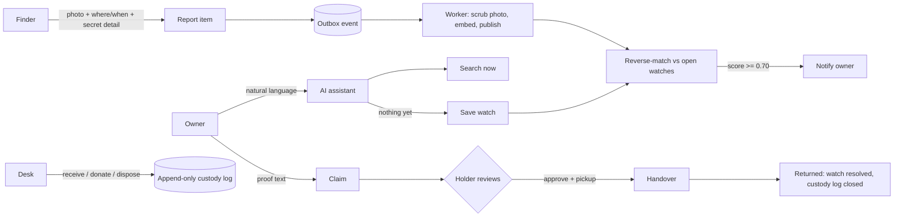

# Campus Lost & Found — system design

## 1. Problem

Lost items on campus are scattered across security desks, department offices and group
chats. Nobody can see the whole picture:

* **Owners** don't know where to look, and chat posts scroll away within hours.
* **Finders** don't know where to take what they found, or have no record they handed it in.
* **Desk staff** keep paper logs, answer the same "did anyone hand in a…" question all day,
  and have no history of who held an item or what happened to it.

**Goal:** one searchable system where finders report items in about a minute, owners describe
what they lost in plain language and get ranked matches *now* or a notification *later*, and
desks track every item from report to return, donation or disposal.

### Success metrics
| Metric | Why it matters |
|---|---|
| Return rate (returned / reported, 30 days) | The outcome that matters. Shown on the desk dashboard |
| Median time from report to return | Speed of reunion |
| Notify precision (eval and live "not mine" rate) | Every false alert erodes trust |
| Time to report a found item | Friction decides whether finders bother |

### Non-goals (v1)
Hardware trackers, payments/rewards, multi-campus federation, replacing physical desks.

---

## 2. Users and core flows



### Item lifecycle (enforced by `app/domain/state_machine.py`)

```
REPORTED --publish--> AVAILABLE --approve_claim--> CLAIMED --return--> RETURNED
                          |  ^                         |
                          |  +------revert_claim-------+
                          +--expire--> EXPIRED --donate/dispose--> DONATED / DISPOSED
                                          +--extend--> AVAILABLE
any non-terminal --remove--> REMOVED
```

Every status change goes through `Machine.next(action, state)`, so an illegal transition
(e.g. donating an item with an approved claim) raises `InvalidTransition` and returns HTTP 409.
Claims and lost reports (watches) have their own machines.

---

## 3. Architecture

**A modular monolith (FastAPI) plus async workers (arq)**, sharing Postgres with pgvector,
Redis and S3-compatible object storage. See [ADR 001](adr/001-modular-monolith.md).

```
Next.js (same-origin /api proxy)
        |
FastAPI  ── auth · campus · items · lost_reports · assistant · claims · notifications · desk
        |          (each module: models / schemas / service / router)
        ├── Postgres 16 + pgvector (HNSW)   all state, vectors, outbox, audit log
        ├── Redis                           job queue, rate limits, login codes, cache
        └── S3 / R2 (S3Mock locally)                     photos (direct browser upload, presigned)
arq workers ── outbox relay · photo scrub · embeddings · matching · email · cron
LLM (optional, OpenAI-compatible: Groq / Gemini / Ollama) behind a circuit breaker
```

### Layering
* `app/domain/` holds pure Python business rules (state machines, matching, extraction, privacy,
  verification) with **no I/O imports**. Fast to test: 43 unit tests run in about 0.1 s.
* `app/modules/*` contains application services, persistence and HTTP for one bounded context each.
* `app/integrations/*` holds adapters (LLM, embeddings, storage, email, images), each behind an
  interface so implementations swap by config.
* `app/workers/*` contains background processing.

---

## 4. Data model

| Table | Key points |
|---|---|
| `campuses`, `locations`, `desks` | Tenant root; locations carry lat/lng for proximity scoring |
| `users` | Role `member` / `desk` / `admin`; desk staff belong to one desk. Unique `(campus_id, lower(email))` |
| `found_items` | Full + **redacted public** copies of text, canonical attributes, `embedding vector(384)`, holder, status, **optimistic `version`** |
| `custody_events` | **Append-only** (DB trigger rejects UPDATE/DELETE): who held it, every claim decision, final disposition |
| `lost_reports` | Standing watches with embedding, time window, expiry |
| `matches` | Unique `(lost_report_id, found_item_id)`, score, components, reasons, status (suggested / notified / dismissed / claimed) |
| `claims` | Proof text + reviewer-only hint score; partial unique indexes: one live claim per person per item, **one approved claim per item** |
| `notifications` | Unique `dedupe_key` makes every notification at-most-once |
| `outbox_events` | Transactional outbox ([ADR 003](adr/003-transactional-outbox.md)) |

**Multi-tenancy:** every tenant row has `campus_id`; every query filters on it, and the JWT
carries it. Adding a second campus is data, not code.

**Indexes worth noting:** HNSW (`vector_cosine_ops`, m=16, ef_construction=64) on both
embedding columns; partial indexes on hot subsets (`status='available'` expiry scan,
`status='open'` watches, unread notifications, unpublished outbox rows).

---

## 5. Matching

Matching is deterministic and explainable. The LLM never ranks ([ADR 002](adr/002-deterministic-matching.md)).

1. **Candidate generation (SQL, hybrid):** hard filters (campus, status, found ≥ lost − 12 h,
   compatible category) + **pgvector ANN top-K ∪ exact item-type top-K/2**. The attribute
   arm rescues items whose text embeds poorly ("TCard" vs "student ID"). pgvector 0.8
   iterative scans keep filtered ANN queries from returning too few rows.
2. **Vetoes:** found before lost (with clock-skew slack); incompatible categories.
3. **Component scores in [0, 1]:** semantic (calibrated cosine), item type (exact / confusable
   pairs such as bag–backpack), colour (same / family / adjacent families), brand, location
   (same place or distance decay), time (half-life of 3 days).
4. **Combine:** weighted mean over *present* signals only (unknown ≠ mismatch), discounted
   slightly when few signals exist. **Explicit contradictions cap the score below the notify
   threshold**: a wrong item type is capped at 0.35, a colour conflict at 0.55. A contradicted pair can
   still be *suggested* when browsing, but never pushed as a notification.
5. **Thresholds:** ≥ 0.45 suggested, ≥ 0.70 notified, at most 15 notifications per new item.

### Measured quality (`make eval`, 30 labelled queries, 32-item pool, hashing embedder)

| recall@1 | recall@3 | MRR | notify precision | false-notify rate |
|---|---|---|---|---|
| 0.96 | 1.00 | 0.98 | 0.96 | 0.00 |

The eval caught two real bugs during development: same-category different-type pairs
(earbuds vs phone) scored 0.84, and colour contradictions (red vs clear bottle) triggered
notifications. Both are now regression tests. CI fails if recall@3 drops below 0.85.

**Feedback loop:** "Not mine" sets a match to `dismissed`; the matcher never revives it, and
dismissed pairs are labelled negatives for future weight tuning.

---

## 6. The AI assistant

Stateless (`POST /assistant/chat` with the running conversation, max 20 messages / 8k chars)
so the API stays horizontally scalable with no session store.

1. **Understand:** rule-based extraction always runs. An LLM (if configured) extracts
   JSON from the conversation; its output is validated and **canonicalised into the same
   vocabulary**, and rule-based results fill any gaps.
2. **Search:** only once the item type is known; otherwise ask exactly one follow-up question,
   prioritised by information value (type → colour → place → time).
3. **Reply:** the LLM writes a short reply from the top matches' *public* fields; otherwise a template.
4. **Watch draft:** returned so one tap saves a standing watch.

**Graceful degradation:** `LLM_PROVIDER=none` is a fully working mode. The LLM client has a
12 s timeout, 2 jittered retries on 429/5xx, and a circuit breaker that fails fast for 30 s
after 4 consecutive failures.

**Prompt-injection boundary:** found-item text is user-generated. It is passed only as a
delimited DATA block, the model has **no tools**, verification secrets and private fields are
**never in context**, output has URLs stripped and is length-capped, and the client renders it
as plain text. Worst case is a misleading sentence, never a data leak.

---

## 7. Reliability

* **Transactional outbox:** a state change and its event commit atomically; the relay publishes
  with `FOR UPDATE SKIP LOCKED` (safe with many replicas) and `_job_id=evt:<id>` (idempotent enqueue).
* **Idempotent consumers:** unique `(lost_report_id, found_item_id)`, unique notification
  `dedupe_key`, status checks before work. Delivery is at-least-once with effectively-once effects.
* **Retries:** exponential backoff in jobs; a cron re-queues items stuck in `REPORTED` > 15 min.
* **Concurrency on claims:** `SELECT … FOR UPDATE` on claim + item, optimistic `version` on items,
  and a partial unique index so two approvals can never both commit (integration-tested).
* **Health:** `/healthz` (liveness, no deps) vs `/readyz` (Postgres + Redis), and statement timeout 10 s.

## 8. Security and privacy

| Threat | Mitigation |
|---|---|
| Account takeover | Passwordless campus-email codes: HMAC-hashed in Redis, 10 min TTL, 5 attempts, single use; JWT in **httpOnly SameSite=Lax** cookie |
| CSRF | SameSite cookie + required `X-Requested-With` header on cookie-authenticated writes |
| Fishing for valuables | No public item list: students only see items matching their own description; the full list is desk-only |
| False claims | Finder's private detail, reviewer-only similarity hint, human approval, 3 attempts per item, rate limits |
| PII leakage | Redaction of emails/phones/ID numbers on write; sensitive item types get generic titles, hidden photos and descriptions until a claim is approved |
| Photo metadata | Worker re-encodes every image (EXIF/GPS stripped), verifies it decodes, caps pixel count |
| Upload abuse | Presigned POST pins key prefix, size (8 MB) and content-type; keys are validated against the user's prefix |
| Tampered history | Append-only custody log enforced in the database |
| Abuse / cost | Redis sliding-window limits per user (assistant 12/min, reports 20/h, claims 10/h, login 8/h) |
| Open redirect | Login `next` only accepts same-site relative paths |

## 9. Scaling

Honest framing: one campus produces maybe thousands of items a year, which a single small
Postgres handles comfortably. The design scales by *shape*, not by heroics:

* **Stateless API**, so add replicas behind a load balancer. **Workers** scale independently.
* **Read path:** campus reference data cached in Redis; keyset pagination everywhere.
* **Write path:** heavy work (images, embeddings, matching) is async; the API returns in ms.
* **Matching cost** is bounded: ANN top-K (50) + scoring in Python is about 1 ms per candidate,
  independent of total rows.
* **Multi-campus:** `campus_id` on every row, so later options are partition by `campus_id` or one DB per region.
* **Next steps if load grows:** read replica for browse; SSE instead of 30 s polling for alerts;
  CDN in front of photos; pgvector `halfvec` to halve index memory; move matching to its own service.

## 10. Trade-offs and alternatives considered

| Decision | Alternative | Why |
|---|---|---|
| Modular monolith | Microservices | One team, one deploy, transactional consistency; modules keep the option to split |
| pgvector | Pinecone / Qdrant | One datastore, transactional with the rows it indexes, free; fine below ~10M vectors |
| arq + Redis | Celery / Kafka | asyncio-native, tiny; outbox gives durability Redis alone doesn't |
| Deterministic matcher | LLM-as-judge | Explainable, testable, free per pair; LLM can't scale to item × open watches |
| Stateless chat | Server-side sessions | No session store, trivially scalable; client sends ≤ 20 messages |
| Email codes | Passwords / SSO | No password storage; SSO (SAML/OIDC) is the production upgrade per campus |
| Polling alerts | WebSockets | Simpler at campus scale; documented upgrade path |
